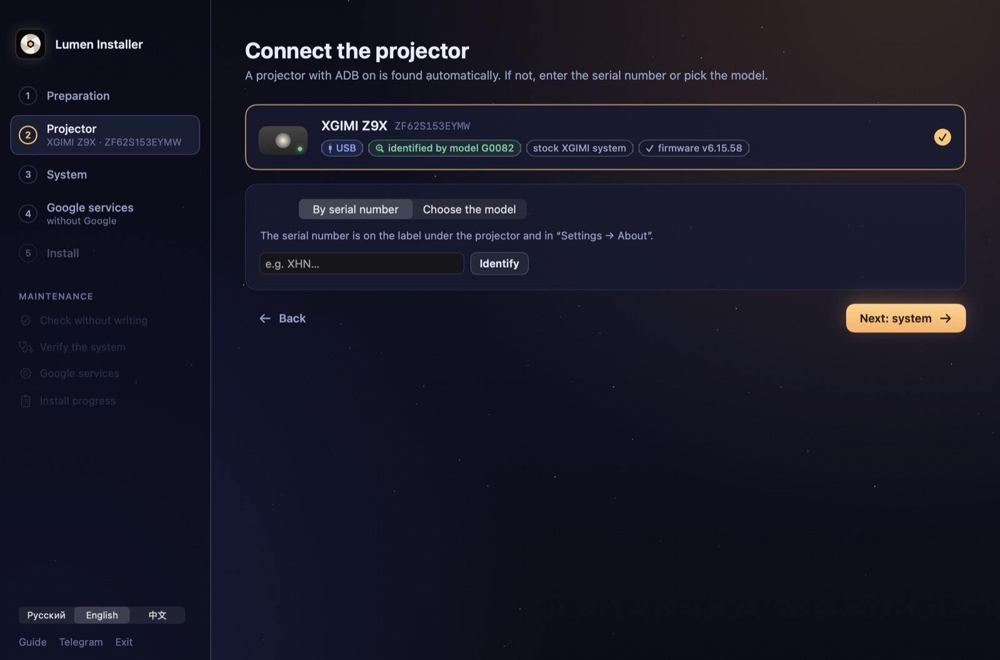
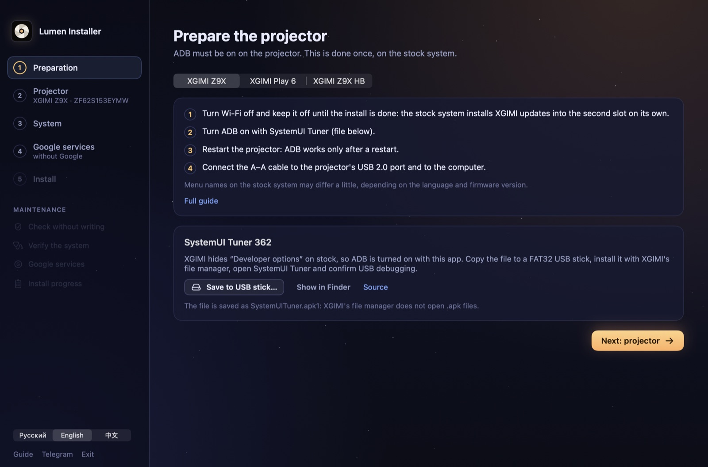
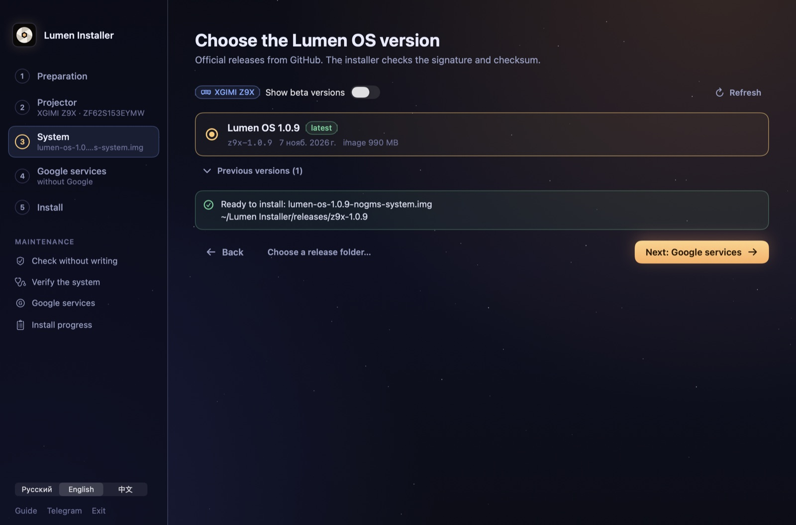
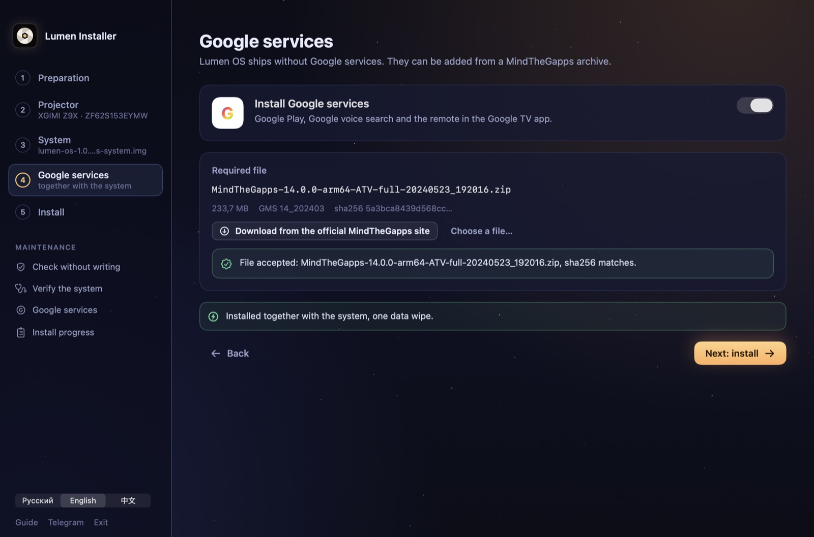
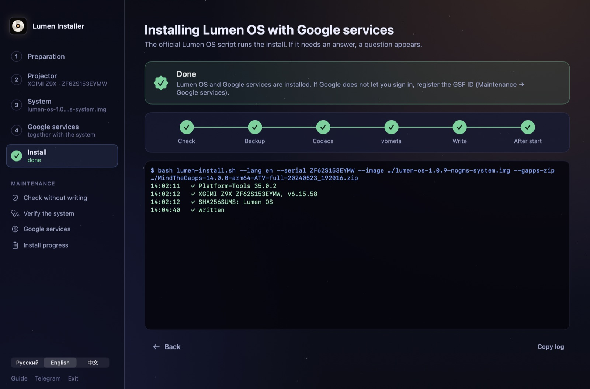

<p align="center">
  
</p>

<h1 align="center">Lumen Installer</h1>

<p align="center">
  A desktop app that installs <a href="https://github.com/Project-Lumen-OS/lumen-os">Lumen OS</a> on XGIMI projectors.<br>
  No terminal: connect the projector, pick a version, press Install.
</p>

<p align="center">
  
  
  
  <a href="README.ru.md"></a>
</p>

<p align="center">
  
</p>

## Supported projectors

| Projector | Connection | Google services |
|---|---|---|
| XGIMI Z9X | USB A–A cable | together with the system |
| XGIMI Play 6 | ADB over Wi‑Fi, the cable only for the write | together with the system |
| XGIMI Z9X HB | ADB over Wi‑Fi, the cable for fastbootd | when the release installer has erofs-utils |

## What it does

- **Preparation.** Short steps for your model, and SystemUI Tuner (the author's APK, sha256 checked) saved to a USB stick
  as `.apk1`, the way XGIMI's file manager accepts it.
- **Finds the projector** over USB, Wi‑Fi and in fastboot mode, and tells the model by its properties. You can also
  enter the serial number or pick the model.
- **Releases from GitHub**, newest first, older ones on request. A release already on disk is used without a new
  download.
- **Google services** from the one MindTheGapps archive the installer accepts, checked before anything is written.
- **The vbmeta step** on a stock Z9X and Z9X HB, with Google's unchanged `vbmeta.img`, after one confirmation.
- **Installs** through the official `lumen-install.sh` / `lumen-install.ps1` of the chosen release and shows its questions
  as dialogs. ERASE and WRITE are typed by you.
- **Russian, English and Chinese.**

The app never writes to the projector itself. Signatures, checksums and the list of partitions that may be written are
checked by the release's own installer.

<table>
  <tr>
    <td></td>
    <td></td>
  </tr>
  <tr>
    <td></td>
    <td></td>
  </tr>
</table>

## Two builds

| | For users | For developers |
|---|---|---|
| macOS | `Lumen Installer.app` | `Lumen Installer Dev.app` |
| Demo projector | – | a simulated XGIMI Z9X with the real installer |
| Self-tests, screenshots | – | `--selftest`, `--selftest-chain`, `--selftest-net`, `--snapshots`, `--readme-shots` |
| Windows | `LumenInstaller.exe` | – |

The developer build is the same app with the `LUMEN_DEV` flag. The user build has no demo at all.

## Build

The app bundles the Lumen OS `installer/` (the device list and pinned checksums before a release is downloaded).
`scripts/get_installer.sh` fetches it from [Project-Lumen-OS/lumen-os](https://github.com/Project-Lumen-OS/lumen-os)
into `vendor/` (only that folder). Set `LUMEN_OS_REF` for another branch or tag, or `LUMEN_OS_DIR` to use a local
checkout.

**macOS** (Xcode 15.3 or newer, macOS 14):

```bash
bash macos/build_app.sh          # macos/dist/Lumen Installer.app
bash macos/build_app.sh --dev    # macos/dist/Lumen Installer Dev.app, with the demo projector
```

**Windows** ([.NET 8 SDK](https://dotnet.microsoft.com/download/dotnet/8.0)):

```powershell
powershell -File scripts\get_installer.ps1
dotnet publish windows\LumenInstaller -c Release -r win-x64 --self-contained false -o windows\publish
```

More about the Windows client: [windows/README.md](windows/README.md).

## How it works

```
Lumen Installer ──► Google Platform-Tools (adb, fastboot; pinned sha256, own adb port 5038)
       │
       └──► lumen-install.sh / .ps1 of the chosen release ──► the projector
             (signature, checksums, allowed partitions)
```

Downloads go to `~/Lumen Installer` (`%USERPROFILE%\Lumen Installer` on Windows). The installer keeps its progress in
`~/.lumen-installer` and continues where it stopped.

## Links

- Lumen OS: [github.com/Project-Lumen-OS/lumen-os](https://github.com/Project-Lumen-OS/lumen-os)
- Install guides: [Z9X](https://github.com/Project-Lumen-OS/lumen-os/blob/main/docs/install/z9x/en.md),
  [Play 6](https://github.com/Project-Lumen-OS/lumen-os/blob/main/docs/install/play6/en.md),
  [Z9X HB](https://github.com/Project-Lumen-OS/lumen-os/blob/main/docs/install/hb/en.md)
- Telegram: [t.me/projector_lumenos](https://t.me/projector_lumenos)

Lumen OS is free and independent: it is not affiliated with XGIMI, Google or MediaTek. Installing it erases all data on
the projector.

## License

[Apache-2.0](LICENSE)
