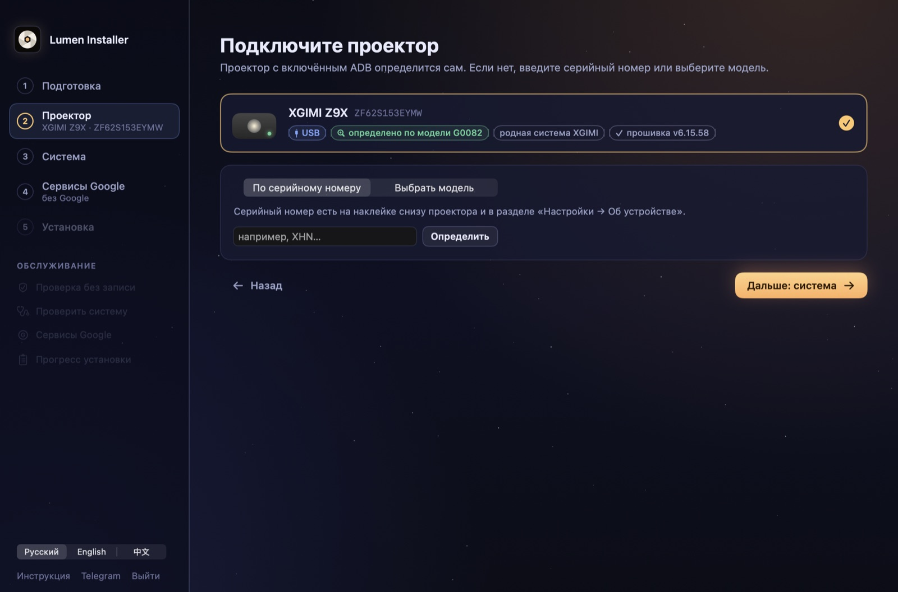
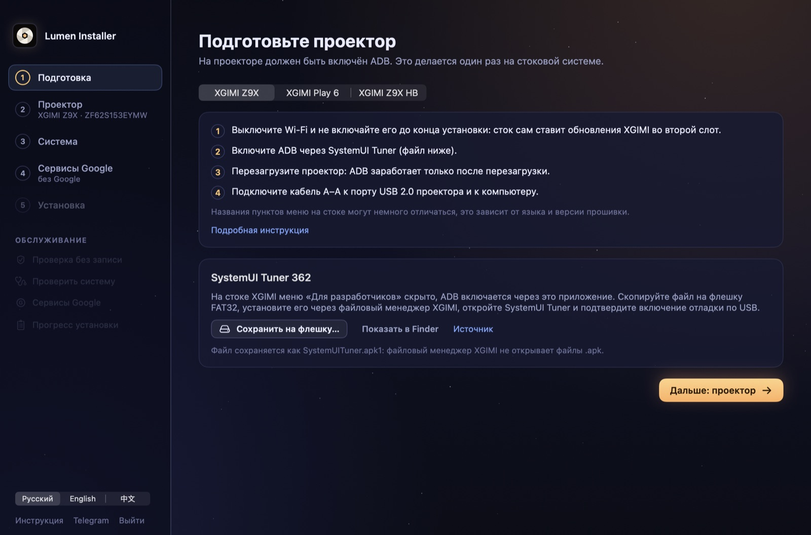
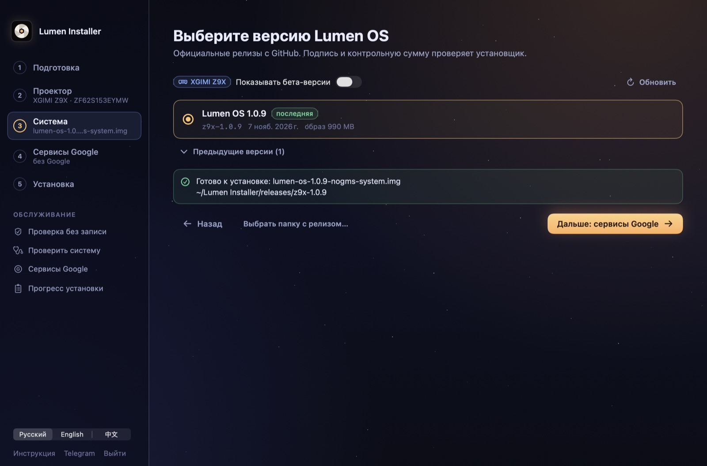
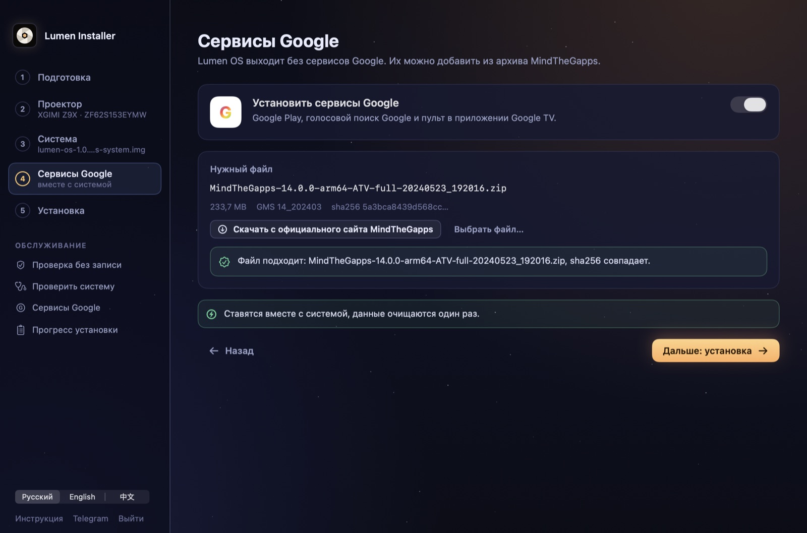
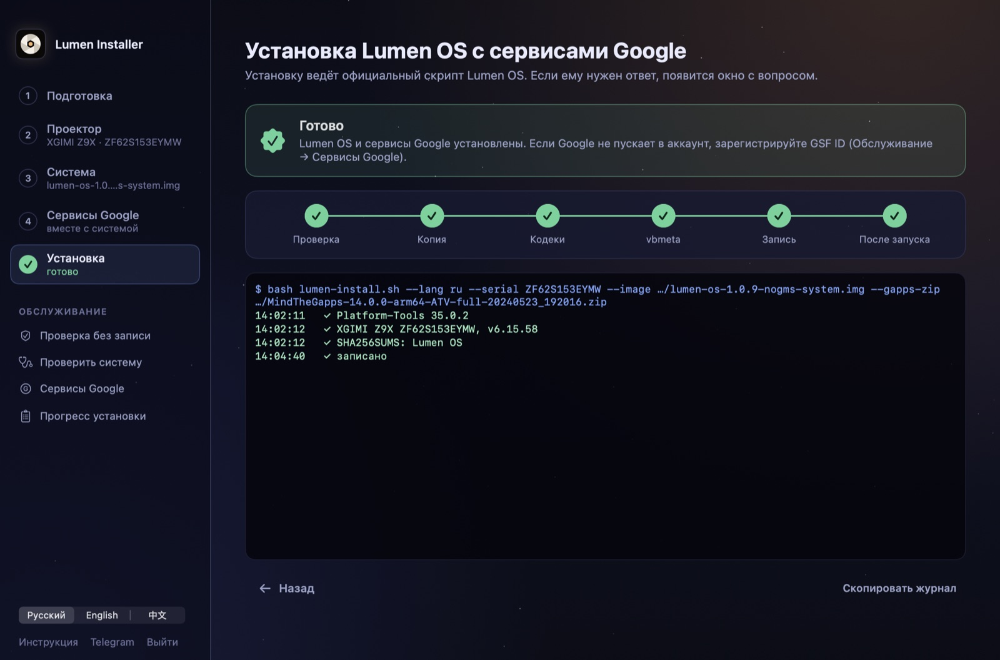

<p align="center">
  
</p>

<h1 align="center">Lumen Installer</h1>

<p align="center">
  Приложение для компьютера, которое ставит <a href="https://github.com/Project-Lumen-OS/lumen-os">Lumen OS</a> на проекторы XGIMI.<br>
  Без терминала: подключите проектор, выберите версию, нажмите «Начать установку».
</p>

<p align="center">
  
  
  
  <a href="README.md"></a>
</p>

<p align="center">
  
</p>

## Какие проекторы

| Проектор | Подключение | Сервисы Google |
|---|---|---|
| XGIMI Z9X | кабель USB A–A | вместе с системой |
| XGIMI Play 6 | ADB по Wi‑Fi, кабель только для записи | вместе с системой |
| XGIMI Z9X HB | ADB по Wi‑Fi, кабель для fastbootd | если в установщике релиза есть erofs-utils |

## Что умеет

- **Подготовка.** Короткие шаги для вашей модели. Здесь же SystemUI Tuner (APK автора, sha256 проверяется) можно
  сохранить на флешку как `.apk1`: так его откроет файловый менеджер XGIMI.
- **Находит проектор** по USB, Wi‑Fi и в режиме fastboot и определяет модель по его свойствам. Модель можно указать и
  по серийному номеру или выбрать из списка.
- **Релизы с GitHub.** Сначала последний, прошлые по кнопке. Уже скачанный релиз используется без повторной загрузки.
- **Сервисы Google** из единственного архива MindTheGapps, который принимает установщик. Файл проверяется до записи.
- **Шаг vbmeta** на стоковых Z9X и Z9X HB: неизменённый `vbmeta.img` от Google, после одного подтверждения.
- **Установка** через официальный `lumen-install.sh` / `lumen-install.ps1` выбранного релиза, его вопросы выводятся
  окнами. ERASE и WRITE вы вводите сами.
- **Русский, английский и китайский.**

Само приложение на проектор ничего не пишет. Подпись, контрольные суммы и список разделов, которые можно трогать,
проверяет установщик самого релиза.

<table>
  <tr>
    <td></td>
    <td></td>
  </tr>
  <tr>
    <td></td>
    <td></td>
  </tr>
</table>

## Две сборки

| | Для пользователей | Для разработчиков |
|---|---|---|
| macOS | `Lumen Installer.app` | `Lumen Installer Dev.app` |
| Демо-проектор | – | симулятор XGIMI Z9X с настоящим установщиком |
| Самопроверки, скриншоты | – | `--selftest`, `--selftest-chain`, `--selftest-net`, `--snapshots`, `--readme-shots` |
| Windows | `LumenInstaller.exe` | – |

Сборка для разработчиков: то же приложение с флагом `LUMEN_DEV`. В сборке для пользователей демо нет совсем.

## Сборка

В приложение входит папка `installer/` из Lumen OS: список моделей и закреплённые контрольные суммы до того, как
скачан релиз. `scripts/get_installer.sh` берёт её из [Project-Lumen-OS/lumen-os](https://github.com/Project-Lumen-OS/lumen-os)
в `vendor/` (только эту папку). Другую ветку или тег задаёт `LUMEN_OS_REF`, локальную копию репозитория задаёт `LUMEN_OS_DIR`.

**macOS** (Xcode 15.3 или новее, macOS 14):

```bash
bash macos/build_app.sh          # macos/dist/Lumen Installer.app
bash macos/build_app.sh --dev    # macos/dist/Lumen Installer Dev.app, с демо-проектором
```

**Windows** ([.NET 8 SDK](https://dotnet.microsoft.com/download/dotnet/8.0)):

```powershell
powershell -File scripts\get_installer.ps1
dotnet publish windows\LumenInstaller -c Release -r win-x64 --self-contained false -o windows\publish
```

Подробнее о клиенте для Windows: [windows/README.md](windows/README.md).

## Как это устроено

```
Lumen Installer ──► Google Platform-Tools (adb, fastboot; закреплённый sha256, свой порт adb 5038)
       │
       └──► lumen-install.sh / .ps1 выбранного релиза ──► проектор
             (подпись, контрольные суммы, разрешённые разделы)
```

Загрузки лежат в `~/Lumen Installer` (на Windows `%USERPROFILE%\Lumen Installer`). Установщик хранит прогресс в
`~/.lumen-installer` и продолжает с места, где остановился.

## Ссылки

- Lumen OS: [github.com/Project-Lumen-OS/lumen-os](https://github.com/Project-Lumen-OS/lumen-os)
- Инструкции: [Z9X](https://github.com/Project-Lumen-OS/lumen-os/blob/main/docs/install/z9x/ru.md),
  [Play 6](https://github.com/Project-Lumen-OS/lumen-os/blob/main/docs/install/play6/ru.md),
  [Z9X HB](https://github.com/Project-Lumen-OS/lumen-os/blob/main/docs/install/hb/ru.md)
- Telegram: [t.me/projector_lumenos](https://t.me/projector_lumenos)

Lumen OS бесплатна и независима: она не связана с XGIMI, Google и MediaTek. Установка стирает все данные на проекторе.

## Лицензия

[Apache-2.0](LICENSE)
